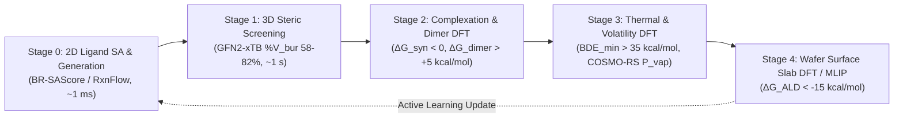

# Synthetic Accessibility (SA) Literature Verification, Open-Source Code & Semiconductor Precursor DFT Repository

[](https://crossref.org)
[-blue.svg)](./downloaded_papers/)
[-purple.svg)](./BIBLIOGRAPHY.md)
[](#6-verified-open-source-repositories--python-api)
[](#13-vasp-centered-4-layer-dft-automation-architecture)
[](./report.md)

This repository provides an end-to-end scientific evaluation, automated DOI/metadata verification, full-text literature archive (`downloaded_papers/`), open-source code reference (17 SA models + 10 VASP automation frameworks), and a **Multi-Fidelity Semiconductor Precursor (ALD/CVD/EUV) + VASP DFT Automation Architecture** presented via a standalone interactive HTML application ([`index.html`](./index.html)).

---

## 1. Scientific Domain Expertise & Theoretical Background

### 1.1 Evolution of Synthetic Accessibility (1st to 4th Generation)

- **1st Gen — Statistical Fragment Heuristics & Bayesian Classifiers (`SAScore`, `SYBA`)**:

  $$
  \text{SAScore}(m) = 10 - 9 \left( \frac{\frac{1}{|F|}\sum_{f \in F} \log_{10} P(f) - \text{ComplexityPenalty}(m) - S_{\min}}{S_{\max} - S_{\min}} \right)
  $$

- **2nd Gen — Reaction Corpus & CASP Surrogate Distillation (`SCScore`, `RAscore`, `RetroGNN`)**:

  $$
  \mathcal{L}_{\text{SCScore}} = -\sum_{(R, P)} \left[ y \ln \sigma(S(P) - S(R)) + (1-y)\ln(1 - \sigma(S(P) - S(R))) \right]
  $$

- **3rd Gen — Graph Attention & Building-Block/Reaction Decoupling (`GASA`, `DeepSA`, `DFRscore`, `BR-SAScore`)**:

  $$
  \text{BR-SAScore}(m) = 10 - 9 \cdot \operatorname{clip}_{[0, 1]}\left( \frac{\frac{1}{|F_R|}\sum_{f \in F_R} s_R(f) - \text{Penalty}_{\text{struct}}(m) + \text{Sym}(m) - S_{\min}}{S_{\max} - S_{\min}} \right)
  $$

  where fragments in commercial building blocks ($BFrag$) are assigned $s_B(f) = 0.0$ (zero penalty), and only reaction-formed fragments ($RFrag$) carry negative log-frequency scores $s_R(f) < 0$.

- **4th Gen — By-Design Synthesizable Generation & Projection (`ChemProjector`, `SynFormer`, `SynFlowNet`, `RxnFlow`, `ReaSyn`)**:

  $$
  \hat{m}_{\text{synth}} = \operatorname*{arg\,min}_{m \in \mathcal{M}_{\text{synth}}} \mathcal{D}_{\text{struct}}(m, m_{\text{target}})
  $$

### 1.2 Extension to Semiconductor Precursors (ALD / CVD) & DFT Synergy

Standard organic SA metrics fail on transition-metal complexes due to RDKit valence/hapticity limitations ($\eta^5\text{-Cp}$, amidinates, dative bonds $L \to M$) and catalog domain shift. We establish a **2-Track SA Extension + 5-Stage DFT Multi-Fidelity Funnel**:

- **Track A (`Si-BR-SAScore` for Covalent Si/Ge/B/Sn Precursors)**: Replaces `emolecules` and `uspto` in `BR-SAScore` with commercial halosilane/disilane catalogs (Gelest) and aminolysis/hydrosilylation reaction templates.
- **Track B (`TMC-SA` for Transition-Metal/Lanthanide Precursors)**: Decomposes $M(L_1)_{n_1}(L_2)_{n_2}$ into neutral pro-ligands $\{HL_i\}$ and metal salt $M\text{X}_m$:

  $$
  \text{SA}_{\text{TMC}}\big(M(L_1)_{n_1}(L_2)_{n_2}\big) = \max_{i} \text{BR-SAScore}(HL_i) + \lambda_{\text{het}} \cdot \mathbf{1}(N_{\text{types}} > 2) + \lambda_{\text{meta}} \cdot \mathcal{P}_{\text{rxn}}(M\text{X}_m, \{HL_i\})
  $$

- **Multi-Fidelity DFT Reward Coupling**:

  $$
  R_{\text{Precursor}}(ML_n) = \sigma\big(\tau_{\text{SA}} - \text{BR-SAScore}(HL)\big) \cdot \sigma\big(-\Delta G_{\text{syn}}^{\text{DFT}}\big) \cdot \mathbf{1}\big(58\% \le \%V_{\text{bur}} \le 82\%\big) \cdot \sigma\left(\frac{\text{BDE}_{\min} - \Delta H_{\text{vap}}}{RT}\right)
  $$

### 1.3 VASP-Centered 4-Layer DFT Automation Architecture

Because VASP uses periodic plane waves (`PAW`), automating both gas-phase organometallic precursors (molecule-in-a-box) and wafer surface ALD reactions (slab + adsorbate) requires a 4-layer stack:

1. **Layer 1 (3D Complex & Slab Builder)**: `molSimplify` (`hjkgrp/molSimplify`) / `Architector` (`lanl/Architector`) for 3D organometallic coordination, paired with `Pymatgen` (`SlabGenerator`, `AdsorbateSiteFinder`, `MVLSlabSet`) and `CatKit` (`SUNCAT-Center/CatKit`) to build asymmetric vacuum boxes ($20 \times 21 \times 22\text{ Å}^3$, `IDIPOL = 4`, `ISYM = 0`) and surface slabs (`IDIPOL = 3`, `LDIPOL = .TRUE.`, `IVDW = 12`).
2. **Layer 2 (MLIP Pre-Relaxation)**: `SevenNet` (`MDIL-SNU/SevenNet`, trained on MPtrj VASP PBE trajectories) or `MACE-MP-0` via `ASE` (`BFGS`) to pre-optimize structures in seconds and cut VASP ionic `NSW` steps by ~80%.
3. **Layer 3 (VASP Workflow & Error Recovery)**: `atomate2` + `jobflow` (`materialsproject/atomate2`), `Quacc` (`Quantum-Accelerators/quacc`), or `AiiDA-VASP` (`aiida-vasp/aiida-vasp`) wrapping **`Custodian`** (`VaspErrorHandler`) to automatically cure `ZBRENT`, `BRMIX`, `EDDDAV`, and `TETIRR` failures.
4. **Layer 4 (Transition States & Thermochemistry)**: `Sella` (`zadorlab/sella`) + `VTST Tools` (`CI-NEB` / Dimer) for $\Delta G^\ddagger_{\text{decomp}}$ and $\Delta G^\ddagger_{\text{ALD}}$, coupled with `ASE` `IdealGasThermo` / `HarmonicThermo`:

   $$
   G_{\text{gas}}^{\text{VASP}}(T, P) = E_{\text{VASP}}^{\text{box}} + E_{\text{ZPE}} + \Delta H_{\text{trans+rot+vib}}(T) - T\Big(S_{\text{trans}}(T, P) + S_{\text{rot}}(T) + S_{\text{vib}}^{\text{QRRHO}}(T) + S_{\text{elec}}\Big)
   $$

### 1.4 AI-Driven Precursor Inverse Design & Substrate-Selective Computational Funnel

To inversely design semiconductor precursors satisfying target multi-objective properties $\mathbf{y}^* = [P_{\text{vap}}^*, \Delta G^\ddagger_{\text{decomp}}^*, \%V_{\text{bur}}^*, \Delta G_{\text{ALD}}^*, \Delta\Delta G_{\text{ads}}^*, S_{\text{ASD}}^*]$, we couple **Inorganic GFlowNet / Conditional 3D Diffusion** with a multi-fidelity computational funnel:

$$\mathcal{L}_{\text{TB}}(\theta) = \left( \ln \frac{Z_\theta \prod_{t=0}^{K-1} P_F(s_{t+1} \mid s_t; \theta)}{R(\mathbf{x}) \prod_{t=0}^{K-1} P_B(s_t \mid s_{t+1}; \theta)} \right)^2$$

#### Substrate-Dependent Adsorption Mechanics & Surface Descriptors
1. **Oxides ($\text{SiO}_2, \text{Al}_2\text{O}_3, \text{HfO}_2$)**:
   - Surface functional termination: Silanol/aluminol Brønsted hydroxyls ($-\text{OH}^*$, $\theta_{\text{OH}} \approx 2.0 \sim 5.0\text{ nm}^{-2}$) and bridging oxygens ($M\text{-O-}M$).
   - Reaction mechanism: Protonolysis / Ligand Exchange ($M L_n(g) + \text{Slab-OH}^* \rightarrow \text{Slab-O-}M L_{n-1}^* + H L(g)$). Driven by ligand basicity ($\text{p}K_a(HL)$) and metal-oxygen bond formation ($\Delta G_{\text{prot}} \le -15\text{ kcal/mol}$).
2. **Nitrides ($\text{TiN}, \text{TaN}, \text{SiN}_x, \text{WN}$)**:
   - Surface functional termination: Amino/imino groups ($-\text{NH}_2^*, =\text{NH}^*$), nitrogen lone pairs ($:\text{N}_{\text{surf}}$), dangling metal bonds (Lewis acid).
   - Reaction mechanism: Lewis acid-base adduct coordination followed by transamination ($M L_n(g) + \text{Slab-N:}^* \rightarrow \text{Slab-N:}\rightarrow M L_n^* \rightarrow \text{Slab-NH-}M L_{n-1}^* + H L(g)$). Governed by precursor Lewis acidity (FIA/HIA) and amine exchange barrier ($\Delta G^\ddagger_{\text{transam}}$).
3. **Metals ($\text{Cu}, \text{W}, \text{Ru}, \text{Mo}, \text{Co}$)**:
   - Surface functional termination: Clean metallic valence electron sea, step/kink edge sites, free of active protons.
   - Reaction mechanism: Physisorption $\rightarrow$ charge-transfer chemisorption, catalytic ligand cracking, and redox transmetalation. Governed by Fermi-level Bader charge transfer ($\Delta q_{\text{Bader}} \le 0.15 e$) and substrate $d$-band center ($\varepsilon_d$).

#### Area-Selective ALD (ASD) Descriptors for Precursor Inverse Design
- **Thermodynamic Selectivity Window**:
  $$\Delta\Delta G_{\text{ads}} = \Delta G_{\text{ads}}(S_{\text{growth}}) - \Delta G_{\text{ads}}(S_{\text{non-growth}}) \le -12.0\text{ kcal/mol}$$
- **Kinetic Sticking Probability Ratio & ASD Metric**:
  $$S_{\text{ASD}} = \frac{s_0(S_{\text{growth}}) - s_0(S_{\text{non-growth}})}{s_0(S_{\text{growth}}) + s_0(S_{\text{non-growth}})} \approx \frac{1 - \exp\left(-\frac{\Delta\Delta G^\ddagger}{RT}\right)}{1 + \exp\left(-\frac{\Delta\Delta G^\ddagger}{RT}\right)} \ge 0.99$$
- **Incubation Cycle Window on Non-Growth Surfaces**:
  $$N_{\text{incubation}} \propto \frac{\Gamma_{\text{defect}}}{\Phi_{\text{dose}} \cdot s_0(S_{\text{non-growth}})} = \frac{\Gamma_{\text{defect}}}{\Phi_{\text{dose}} \cdot \kappa}\exp\left(\frac{\Delta G^\ddagger_{\text{nuc}}}{RT}\right) \ge 50 \sim 100\text{ cycles}$$

---

## 2. Strategic Objectives

1. **Empirical Literature Audit (25 Papers)**: Verify all DOIs, titles, and author lists across 14 core SA papers, 5 CASP/benchmark works, and 6 semiconductor/materials precursor studies.
2. **Local Corpus Acquisition (21 Full Texts)**: Archive 19 open-access/contributed PDFs and 2 PMC full-text XMLs in `downloaded_papers/` (84% complete archive rate).
3. **Open-Source Code & Package Audit (27 Repositories)**: Verify GitHub URLs, PyPI distributions (`BRSAScore==0.1.1`), licenses, and executable Python API snippets across 17 SA models and 10 VASP automation frameworks.
4. **Semiconductor Precursor & VASP DFT Architecture**: Formulate actionable computational workflows coupling 2D SA metrics with GFN2-xTB, SevenNet/MACE pre-relaxation, molecular VASP DFT ($\Delta G_{\text{syn}}, \Delta G_{\text{dimer}}, \text{BDE}_{\min}$), and slab VASP DFT/Sella TS calculations ($\Delta G_{\text{ALD}}, \Delta G^\ddagger_{\text{ALD}}$).

---

## 3. Architecture Map & Directory Structure

### 3.1 Workspace Structure
```
synth_acc/
├── database/                            # Proprietary Semiconductor Precursor & Reaction Domain DB
│   ├── precursors.json                 # 27 commercial ALD/CVD/EUV precursors (Si, Hf, Zr, Ti, Al, W, Mo, Ru, Co, Sn)
│   ├── precursors.csv                  # Tabular summary with vapor pressures, decomposition temp, yields, vendors
│   ├── building_blocks.json            # 29 inorganic halide cores, alkyls, pro-ligands, and lithiated bases
│   ├── building_blocks.csv             # Formatted table of precursor starting materials with CAS and purity grades
│   ├── reactions.json                  # 12 authenticated synthesis reaction pathways with SMARTS & deltaG
│   ├── reactions.csv                   # Synthesis reaction database table
│   └── br_sascore_inputs/              # Formatted inputs ready for BR-SAScore dictionary generator
│       ├── semi_bb.csv                 # Commercial semiconductor building block SMILES for BFrag (score = 0.0)
│       └── semi_rxn.csv                # Semiconductor synthesis reactions for RFrag
├── downloaded_papers/                   # Local archive of 21 full-text papers + JSON manifests
│   ├── SAScore_2009.pdf                # Ertl & Schuffenhauer (J. Cheminform. 2009)
│   ├── SYBA_2020.pdf                   # Voršilák et al. (J. Cheminform. 2020)
│   ├── RAscore_2021.pdf                # Thakkar et al. (Chem. Sci. 2021)
│   ├── RetroGNN_2022.pdf               # Liu et al. (JCIM 2022)
│   ├── DeepSA_2023.pdf                 # Wang et al. (J. Cheminform. 2023)
│   ├── BR_SAScore_2024.pdf             # Chen & Jung (J. Cheminform. 2024)
│   ├── ChemProjector_2024.pdf          # Luo et al. (NeurIPS 2024)
│   ├── SynFormer_2025.pdf              # Chuang et al. (PNAS 2025)
│   ├── SynFlowNet_2025.pdf             # Cretu et al. (ICLR 2025)
│   ├── RxnFlow_2025.pdf                # Seo et al. (NeurIPS 2024)
│   ├── ReaSyn_2025.pdf                 # KAIST & NVIDIA (2025)
│   ├── SynNet_2022.pdf                 # Gao, Mercado, Coley (ICLR 2022)
│   ├── Gao_Coley_Benchmark_2020.pdf    # Gao & Coley (JCIM 2020)
│   ├── AiZynthFinder_2020.pdf          # Genheden et al. (J. Cheminform. 2020)
│   ├── RetroStar_2020.pdf              # Chen et al. (ICML 2020)
│   ├── Kulik_TMC_SA_2022.xml           # Duan, Nandy, Kulik (JACS Au 2022 Full-Text XML)
│   ├── MPScore_Jelfs_2021.xml          # Bennett, Jelfs et al. (JCIM 2021 Full-Text XML)
│   ├── AS_ALD_Precursor_ML_2023.pdf    # Van, Kim et al. (J. Mol. Model. 2023, 2.6 MB)
│   ├── ALD_MLIP_Precursor_2024.pdf     # Kang, Kim, Won et al. (Mater. Today Adv. 2024, 6.3 MB)
│   ├── ALD_ML_ChemMater_2026.pdf       # Westermayr, Bent, Tonner-Zech (Chem. Mater. 2026, 3.1 MB)
│   ├── Aminosilane_SiO2_ALD_DFT_2017.pdf # Huang, Han, Cheng et al. (RSC Adv. 2017, 736 KB)
│   ├── manifest.json                   # Complete verification metadata for all 25 papers
│   ├── repos_and_precursors.json       # Verified GitHub/PyPI repository & precursor audit
│   └── vasp_frameworks.json            # 10 verified VASP automation frameworks metadata
├── index.html                          # Primary interactive HTML report (11 Sections, KaTeX + Mermaid)
├── synthetic_accessibility_report.html  # Synchronized copy of the HTML report
├── template.html                       # Master HTML template
├── build_semiconductor_db.py           # Semiconductor database generation and RDKit validation engine
├── benchmark_precursor_pipeline.py     # SAScore benchmark & VASP POSCAR box builder test script
├── download_all.py                     # Core literature DOI verification & PDF fetcher
├── verify_github_and_precursors.py     # GitHub API & semiconductor precursor verifier
├── generate_html.py                    # HTML compilation harness
├── report.md                           # Formal verification and audit report
└── README.md                           # Project specification and documentation
```

### 3.2 Multi-Fidelity Precursor Design Workflow


---

## 4. Operational Harness & Execution

```bash
# 1. Verify core DOIs and download open-access PDFs
python download_all.py

# 2. Verify GitHub repositories and semiconductor precursor literature
python verify_github_and_precursors.py

# 3. Compile index.html and synthetic_accessibility_report.html
python generate_html.py
```

---

## 5. Physical Standards & Citation References (34 Verified DOIs)

> [!NOTE]
> For the complete section-by-section categorized bibliography, local file paths, and ready-to-use BibTeX collection, see [**`BIBLIOGRAPHY.md`**](./BIBLIOGRAPHY.md).

### 5.1 Physical Units & Target Precursor Thresholds
| Physical Quantity | Symbol | Unit | Target Precursor Threshold |
| :--- | :--- | :--- | :--- |
| **Pro-Ligand Synthetic Accessibility** | $\text{BR-SAScore}(HL)$ | dimensionless ($1\text{--}10$) | $< 3.5$ |
| **Percent Buried Volume** | $\%V_{\text{bur}}$ | $\%$ (at $R_s = 3.5\text{ Å}$) | $58\% \sim 82\%$ (monomeric window) |
| **Complexation Reaction Free Energy** | $\Delta G_{\text{syn}}$ | $\text{kcal/mol}$ | $< 0.0\text{ kcal/mol}$ (exergonic) |
| **Dimerization Free Energy** | $\Delta G_{\text{dimer}}$ | $\text{kcal/mol}$ | $> +5.0\text{ kcal/mol}$ (prevents oligomerization) |
| **Minimum Bond Dissociation Energy** | $\text{BDE}_{\min}$ | $\text{kcal/mol}$ | $> 35.0\text{ kcal/mol}$ (survives distillation) |
| **$\beta$-H / Thermal Decomposition Barrier** | $\Delta G^\ddagger_{\text{decomp}}$ | $\text{kcal/mol}$ | $> 28.0\text{ kcal/mol}$ |
| **Wafer Half-Cycle Chemisorption Energy** | $\Delta G_{\text{ALD}}$ | $\text{kcal/mol}$ | $< -15.0\text{ kcal/mol}$ (self-limiting reaction) |

### 5.2 Complete Citation Registry (34 Verified DOIs)
1. **SAScore**: `10.1186/1758-2946-1-8`
2. **SYBA**: `10.1186/s13321-020-00439-2`
3. **SCScore**: `10.1021/acs.jcim.7b00622`
4. **RAscore**: `10.1039/D0SC05401A`
5. **RetroGNN**: `10.1021/acs.jcim.1c01476`
6. **GASA**: `10.1021/acs.jcim.2c00038`
7. **DeepSA**: `10.1186/s13321-023-00771-3`
8. **DFRscore**: `10.1021/acs.jcim.3c01134`
9. **BR-SAScore**: `10.1186/s13321-024-00879-0`
10. **ChemProjector**: `10.48550/arXiv.2406.04628`
11. **SynFormer**: `10.1073/pnas.2415665122`
12. **SynFlowNet**: `10.48550/arXiv.2405.01155`
13. **RxnFlow**: `10.48550/arXiv.2410.04542`
14. **ReaSyn**: `10.48550/arXiv.2509.16084`
15. **SynNet**: `10.48550/arXiv.2110.06389`
16. **Generative SA Benchmark**: `10.1021/acs.jcim.0c00174`
17. **AiZynthFinder**: `10.1186/s13321-020-00472-1`
18. **Retro***: `10.48550/arXiv.2006.15575`
19. **V-SYNTH**: `10.1038/s41586-021-04220-9`
20. **TMC Synthesizability (Kulik Group)**: `10.1021/jacsau.2c00547`
21. **MPScore (Jelfs Group)**: `10.1021/acs.jcim.1c00375`
22. **AS-ALD Precursor ML Descriptors**: `10.1007/s00894-023-05806-y`
23. **MLIP for ALD Precursors**: `10.1016/j.mtadv.2024.100474`
24. **ML in ALD Roadmap**: `10.1021/acs.chemmater.5c03271`
25. **Aminosilane SiO2 ALD Precursor DFT**: `10.1039/c7ra02301d`
26. **Oh et al. (ASD Precursor Choice)**: `10.1021/acs.chemmater.0c04718`
27. **Tonner-Zech et al. (ASD Design Principles)**: `10.1002/jcc.27488`
28. **Mackus et al. (ASD Fundamentals & Metrics)**: `10.1021/acs.chemmater.8b03454`
29. **Parsons & Clark (ASD State-of-the-Art)**: `10.1021/acs.chemmater.0c00722`
30. **Pymatgen (Materials Genomics)**: `10.1016/j.commatsci.2012.10.028`
31. **atomate2 + jobflow**: `10.1039/D5DD00019J`
32. **AiiDA-VASP Automation**: `10.1038/s41597-020-00638-4`
33. **Architector (3D TMC Complex Builder)**: `10.1021/acs.jcim.2c01618`
34. **Sella (Automated Saddle-Point TS)**: `10.1021/acs.jctc.1c01143`
